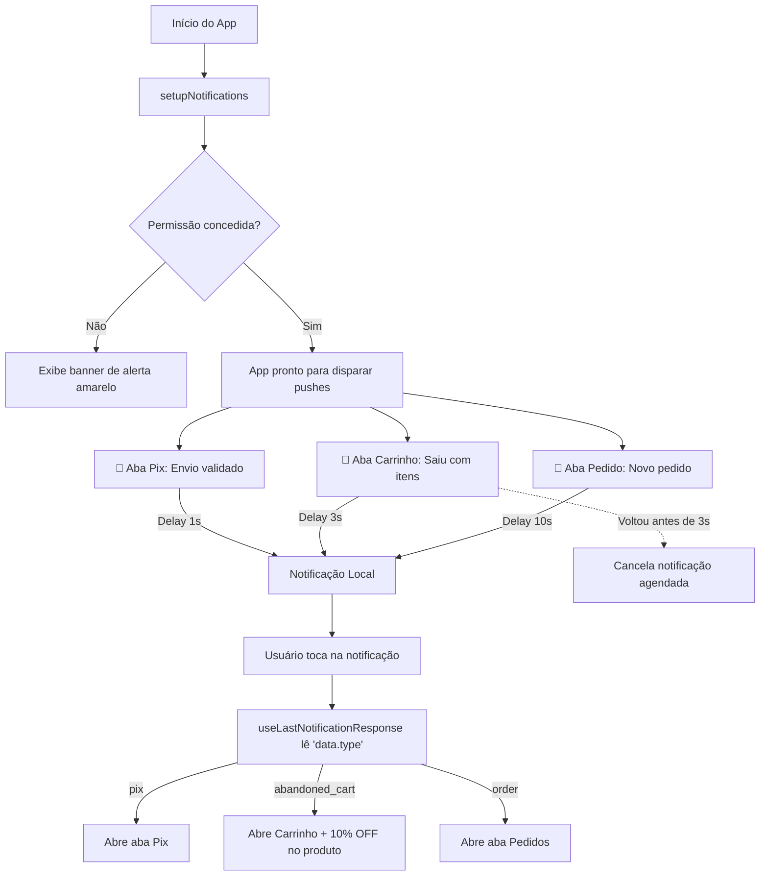

# 🔔 Painel de Push — Protótipo de Notificações Mobile


Protótipo mobile desenvolvido em **React Native + Expo** para demonstrar, na prática, diferentes estratégias de **notificações push (simuladas localmente)**, agendamento, cancelamento inteligente e **navegação contextual ao tocar na notificação** (*deep linking* interno).

---

## 🎯 Funcionalidades Demonstradas

O aplicativo é dividido em **3 abas**, cada uma representando um caso de uso real de mercado:

| Aba | Cenário de Uso | Comportamento da Notificação | Ação ao Tocar no Push |
| :--- | :--- | :--- | :--- |
| 💸 **Pix** | Confirmação transacional | Dispara **1 segundo** após validar valor, chave e senha (`123456`). | Direciona para a aba **Pix**. |
| 🛒 **Carrinho** | Recuperação de carrinho abandonado | Ao sair da aba com itens no carrinho, agenda push para **3 segundos**. Se o usuário voltar antes, o push é **cancelado**. | Volta para o **Carrinho** e aplica **10% de desconto** no último item adicionado. |
| 🍔 **Pedido** | Atualização de status (Delivery) | Ao fazer um pedido, cria o item como *"Aguardando"* e agenda push + mudança para *"Em preparo 👨‍🍳"* após **10 segundos**. | Direciona para a aba **Pedido**. |

---

## 🔄 Fluxo das Notificações (Arquitetura)



---

## 🛠️ Tecnologias Utilizadas

* **React Native**: Framework para construção de interfaces mobile nativas com JavaScript/React.
* **Expo**: Ecossistema que simplifica o desenvolvimento, build e execução em emuladores (Android Studio / Pixel) e dispositivos físicos via **Expo Go**.
* **`expo-notifications`**: Biblioteca responsável por:
  * Criar canais de notificação no Android (`setNotificationChannelAsync` com importância `MAX` para exibir *heads-up banner* e vibração).
  * Solicitar e verificar permissões do sistema operacional (`getPermissionsAsync` / `requestPermissionsAsync`).
  * Agendar e cancelar notificações (`scheduleNotificationAsync` / `cancelScheduledNotificationAsync`).
  * Capturar o clique do usuário na notificação (`useLastNotificationResponse`).
* **React Hooks (`useState`, `useEffect`, `useRef`)**: Gerenciamento de estado das abas, carrinho, pedidos, controle de troca de tela e armazenamento de IDs de notificações agendadas sem causar re-renderizações desnecessárias.

---

## 🚀 Como Executar o Projeto

### Pré-requisitos
* [Node.js](https://nodejs.org/) instalado.
* **Android Studio** (com emulador Pixel configurado) ou celular físico com o app **Expo Go**.

### Passo a passo
1. Instale as dependências do projeto:
   ```bash
   npm install
   ```
2. Certifique-se de ter a biblioteca de notificações instalada:
   ```bash
   npx expo install expo-notifications
   ```
3. Inicie o servidor do Expo:
   ```bash
   npx expo start
   ```
4. Pressione **`a`** no terminal para abrir no emulador Android (ou escaneie o QR Code no Expo Go).

> ⚠️ **Atenção no Android 13+ / Emulador Pixel:**  
> Caso as notificações não apareçam, acesse **Configurações do aparelho > Apps > Expo Go (ou seu App) > Notificações** e verifique se a permissão está ativada.

---

## 🎤 Roteiro Rápido de Demonstração (Apresentação)

1. **Aba Pix**: Preencha um valor (ex: `50,00`), uma chave qualquer e a senha **`123456`**. Clique em *Enviar Pix* e observe a notificação chegar em **1s**.
2. **Aba Carrinho (Cancelamento)**: Adicione um produto, troque de aba e **volte rapidamente (antes de 3s)** — mostre que o push foi cancelado.
3. **Aba Carrinho (Conversão com Desconto)**: Troque de aba novamente e **aguarde 3s**. Quando o push chegar, **toque nele**: o app retorna automaticamente ao carrinho com o banner de **10% OFF** aplicado ao produto.
4. **Aba Pedido**: Clique em *Pedir* em qualquer item do cardápio. Mostre o status inicial (*"Aguardando"*) e, após **10s**, veja a notificação chegar sincronizada com a atualização para *"Em preparo 👨‍🍳"*.

---

## ⚙️ Parâmetros Configuráveis no Código

No topo do arquivo `App.js`, é possível ajustar facilmente os tempos e regras de negócio para testes:

```javascript
const PIX_PASSWORD = '123456'; // Senha fixa para validação do Pix
const CART_DISCOUNT = 0.1;     // Percentual de desconto (0.1 = 10%)
const ABANDON_DELAY_S = 3;     // Tempo (em segundos) para push de carrinho abandonado
const ORDER_DELAY_S = 10;      // Tempo (em segundos) para mudança de status do pedido
```